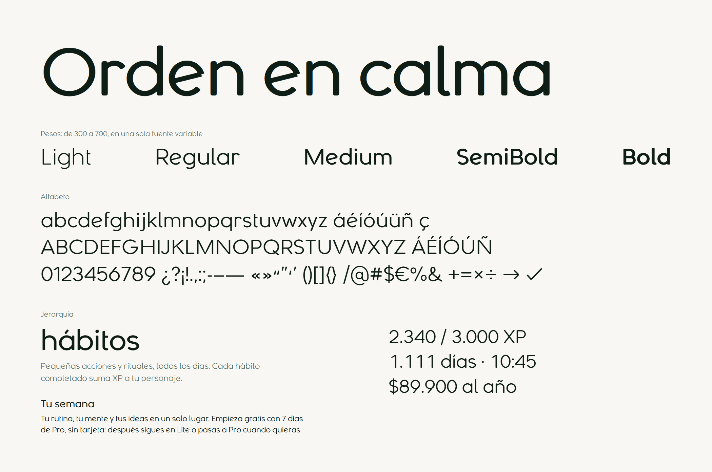

# Nout Sans

La tipografía de NoutLife. Geométrica y monolineal, con remates de corte recto y esquinas suavizadas. La usa toda la plataforma: títulos, subtítulos, barra lateral, cuerpo y cifras. Es propia: cada letra está trazada por código en [`scripts/font/nout_sans.py`](../../scripts/font/nout_sans.py), sin partir de ninguna otra fuente.



## Archivos

| Archivo | Para qué |
|---|---|
| `src/assets/fonts/nout-sans.woff2` | La web. Variable, peso de 300 a 700, 23 KB. `index.html` la precarga. |
| `design/type/NoutSans[wght].ttf` | La misma fuente variable, para herramientas que la admiten. |
| `design/type/NoutSans-Light.ttf`, `-Regular`, `-Medium`, `-SemiBold`, `-Bold` | Estáticas, con los trazos ya unidos, para Figma, Word o impresión. |

Cubre 343 caracteres: Latin-1, casi todo Latin Extended-A (nombres de personas), comillas, guiones, €, flechas y palomita. Lo demás (cirílico, griego, emoji) cae en la fuente del sistema.

## Cómo es

- **Pluma elíptica.** Es más ancha que alta, así que las horizontales salen un 8 % más finas que las verticales. El texto se ve parejo sin perder el aire monolineal.
- **Remates suaves.** Corte recto con las esquinas redondeadas al 62 % del medio trazo. Se notan en los títulos; a tamaño de texto solo quitan dureza.
- **Empalmes abiertos.** El arco de la n y los cuencos de la a, la b o la d adelgazan al tocar el asta. Así no se forma un nudo oscuro.
- **Rasgos propios.** a y g de un solo piso. e con la barra inclinada, herencia del wordmark. l y t con una cola corta, que separa `l`, `I` y `1`. 6 y 9 con el asta recta.
- **Cifras.** Proporcionales por defecto y tabulares con `tabular-nums` (la clase `font-mono` ya las activa). Nada de la app usa una fuente monoespaciada.

El wordmark «noutlife» del logo no se escribe con esta fuente. Es un dibujo aparte y no se recompone con texto.

## Escala

Los tokens viven en [`tailwind.config.ts`](../../tailwind.config.ts). El tamaño y el color separan los niveles; el peso apenas interviene.

| Token | Tamaño / línea | Peso | Tracking | Uso |
|---|---|---|---|---|
| `display-lg` | 56 / 62 | 500 | −0,015 em | Título de zona en escritorio |
| `display-md` | 40 / 46 | 500 | −0,015 em | Título de zona en tableta |
| `display-sm` | 32 / 40 | 500 | −0,01 em | Título de zona en móvil |
| `heading-lg` | 24 / 32 | 500 | −0,005 em | Encabezado de sección |
| `heading-md` | 20 / 28 | 500 | 0 | Encabezado de tarjeta |
| `heading-sm` | 18 / 26 | 500 | 0 | Encabezado pequeño |
| `body-lg` | 16 / 24 | 400 | 0 | Introducciones |
| `body-md` | 15 / 22 | 400 | 0 | Texto corriente |
| `body-sm` | 14 / 20 | 400 | 0 | Barra lateral, texto de apoyo |
| `label-lg` | 14 / 20 | 500 | 0 | Botones, etiquetas |
| `label-md` | 12 / 18 | 500 | +0,01 em | Etiquetas pequeñas |
| `caption` | 12 / 18 | 400 | 0 | Notas, rótulos de sección |

## Reglas

1. **Títulos de zona en minúsculas**, con `<Lettering>` o `<TitleText>`: es la voz del logo. El texto sigue siendo real y conserva su caja para los lectores de pantalla y las búsquedas.
2. **El texto secundario va en peso 350.** La clase `text-on-surface-light` ya lo aplica, y las clases de peso explícitas mandan sobre ella. Solo sobre el color `on-surface-light`, que da más de 4,5:1 sobre las superficies del tema.
3. **No se pasa de 600 en la interfaz.** `font-semibold` equivale a 500 y `font-bold` a 600. El peso 700 queda para piezas fuera de la app.
4. **Sin mayúsculas sostenidas para rotular.** Los rótulos de sección van en `caption`, en caja normal.
5. **No bajar de 12 px.** Por debajo, los trazos finos pierden contraste, sobre todo en las pantallas de 1×.
6. **Barra lateral:** la pestaña activa en `font-medium`, las demás en 400.

Los temas de la Tienda cambian `--lq-font-sans` por su propia fuente (Nunito, EB Garamond, etc.). La escala y las reglas siguen valiendo. Las citas de Sabiduría siguen en EB Garamond a propósito.

## Regenerar

```bash
# desde apps/web; usa el Python de Blender 4.5 (BLENDER_PYTHON cambia la ruta)
node scripts/build-font.mjs
npm test    # tests/unit/type.unit.ts
```

La primera vez instala fontTools, brotli y skia-pathops en `~/Tools/font-deps`. El script se detiene si falta un carácter que la app usa, si el eje de peso no es 300–700 o si las cifras tabulares no miden todas lo mismo.

Para cambiar una letra, se edita su esqueleto en `nout_sans.py` y se regenera. No se retocan los TTF a mano. Los dos maestros (300 y 700) tienen que conservar los mismos puntos: la interpolación depende de eso.

## Licencia

Tipografía propietaria de NoutLife. Los archivos llevan ese aviso en sus metadatos. No hay fuentes de terceros en su origen, así que no arrastra obligaciones de licencia.
